# Gabriel Elías Valdelamar Caldera

  

  
  
  

## 🇪🇸 Sobre mí | 🇬🇧 About me

🇨🇴 Desarrollador Full Stack y estudiante de Ingeniería de Sistemas, enfocado en construir aplicaciones web, APIs e integraciones escalables. Me interesa la arquitectura de software, la automatización de procesos y el desarrollo asistido por inteligencia artificial.

🇬🇧 Full Stack Developer and Systems Engineering student focused on building web applications, APIs, and scalable integrations. Interested in software architecture, process automation, and AI-assisted development.

- 💻 **Enfoque / Focus:** Full Stack Development, REST APIs & Integrations.
- 🧠 **Intereses / Interests:** AI, automation, software architecture & security.
- 📍 **Ubicación / Location:** Cartagena, Colombia.
- 🌐 **Idiomas / Languages:** Spanish (Native) · English (B2).

## 🛠️ Tech Stack

  

**Additional tools:** Sequelize, JWT, Zod, Vitest, Coolify, n8n, Microsoft Graph, Zoho CRM, HubSpot, Cloudflare R2, OpenRouter and LLM integrations.

## 📊 GitHub Dashboard

### GitHub Statistics

  
  

### Contribution Activity

  

## 🚀 Featured Projects

### [OrderEasy — Lumxis](https://github.com/GEliasDev/OrderEasy)

Inventory, sales and cash management system designed to streamline business operations.

- REST API with role-based access control and multi-user support.
- AI assistant powered by OpenRouter and function calling, with human confirmation before destructive actions.
- **Stack:** Node.js · Express · PostgreSQL · Sequelize · JWT · AI integration.

### [Debti](https://github.com/GEliasDev/SoftwareFinanciero)

Personal finance application focused on the Colombian market.

- Credit tracking, French amortization schedules, and late-payment calculations.
- Security features including JWT and TOTP-based two-factor authentication.
- Android app with Capacitor, automated CI/CD, and tests with Vitest.
- **Stack:** TypeScript · PostgreSQL · Capacitor · GitHub Actions · Vitest.
- **[Live demo](https://debti-web.onrender.com)**

## 💼 Experience

- **AED Constructores — Full Stack Developer**  
  Business applications, database-backed systems, third-party integrations, and workflow automation.

- **Blaze Lifestyle — Freelance Developer**  
  Progressive Web App for nutrition, exercise, and body-composition tracking.

- **Colegio Jorge Washington — Software Development**  
  Process automation and internal tools using Google Apps Script, Firebase, and Excel.

## 🎓 Education

- **Systems Engineering** — Fundación Universitaria Tecnológico de Comfenalco *(In progress)*.
- **Software Development Technology** — Fundación Universitaria Tecnológico de Comfenalco.

## 📫 Let's connect

  <a href="https://github.com/GEliasDev">GitHub</a> ·
  <a href="https://www.linkedin.com/in/gabriel-el%C3%ADas-valdelamar-caldera-b48502383/">LinkedIn</a> ·
  <a href="mailto:gvaldelamar2003@outlook.com">Email me</a>

  <i>Building useful software, one commit at a time.</i>

